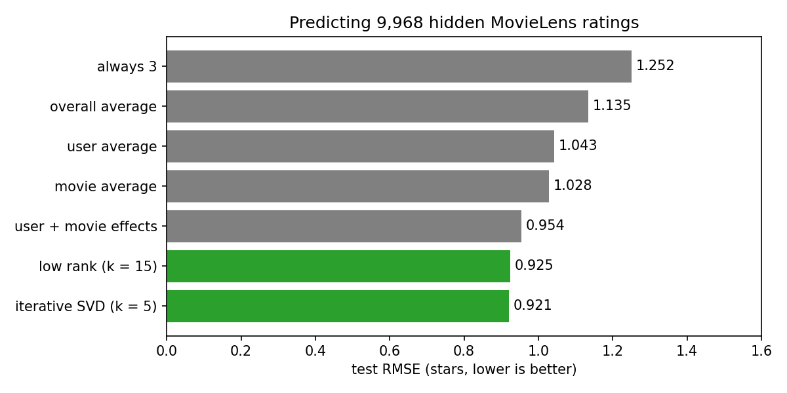
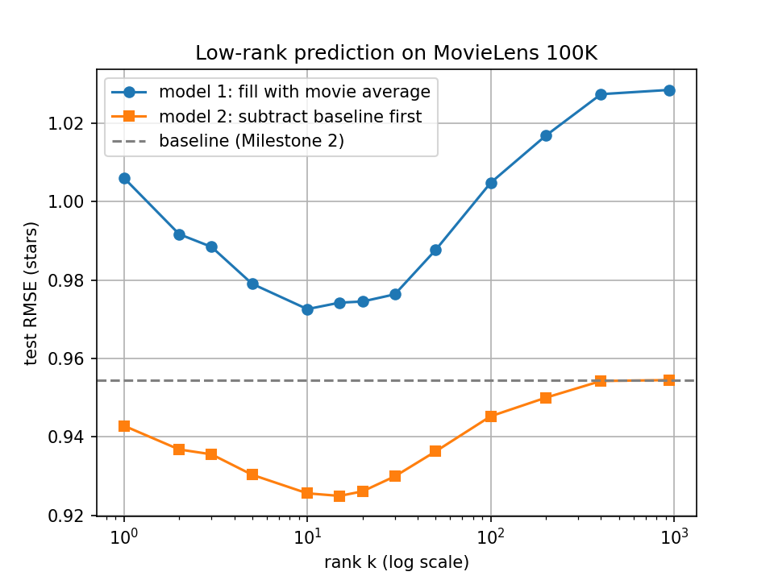

# Predicting Movie Ratings with Low-Rank Matrices

**Our best model predicts hidden ratings to within 0.92 stars (RMSE), 3.6% better than the best simple baseline (0.954), and without being told any genres it discovered a "sci-fi and action vs. musicals and family films" taste factor.**

## The question
Can you predict what someone will like from what everyone else likes? We test this on MovieLens 100K: 100,000 ratings of 1,682 movies by 943 users.

## The idea
Put the ratings in a matrix: one row per user, one column per movie. 94% of it is empty. If tastes depend on a few hidden factors, the full matrix should be close to low rank. We predict the baseline (average + user effect + movie effect), then let the SVD fill in the personal part with its best rank-k approximation. We hid 10% of the ratings (9,968) as a test set and never used them to build any model.

## Results
1. **Low rank beats averages, but only with the baseline subtracted.** Filling gaps with movie averages never beats the baseline (best 0.973 at k = 10 vs. 0.954), but subtracting the baseline first reaches 0.925 at k = 15, and iterative SVD reaches 0.921 at k = 5. Large k overfits.

   

2. **What it learned.** Without being told any genres, the SVD found a "sci-fi and action vs. musicals and family films" factor. From just 10 of my ratings it moved Star Trek: First Contact up by 0.22 stars and The English Patient down by 0.36, although 6 of its top 10 picks were the same crowd favorites the simple average recommends.

## Limitations
- With only 10 ratings, a new user mostly gets the same crowd favorites as everyone else (6 of 10 picks match the baseline).
- Only some factors have a clean human name; the improvement over the baseline is a few percent, measured on one train/test split.
- The data is from 1998, so it only knows older movies.

## How to run it
Open any notebook in `notebooks/`, click "Open in Colab", then Runtime -> Run all. Each notebook downloads the data itself. Our functions are in `src/evaluate.py` and `src/models.py`.

## Data and references
- MovieLens 100K, GroupLens Research (https://grouplens.org/datasets/movielens/100k/). Not included here, as required by its license.
- F. M. Harper and J. A. Konstan (2015), The MovieLens Datasets: History and Context, ACM TiiS 5(4).
- C. Eckart and G. Young (1936), The approximation of one matrix by another of lower rank, Psychometrika 1, 211-218.

## Use of AI tools
Code in notebooks 01-03 came from the course milestone handouts, with my edits; I wrote the explanations myself, and Claude was used to check them and the code. For Milestones 4 and 5, Claude Code (Anthropic) assembled notebooks 04 and 05, tidied the repository, ran the code to get the numbers, and drafted this README.

## About
Henry Monteith, MATH 344L, University of South Carolina, Fall 2026.
